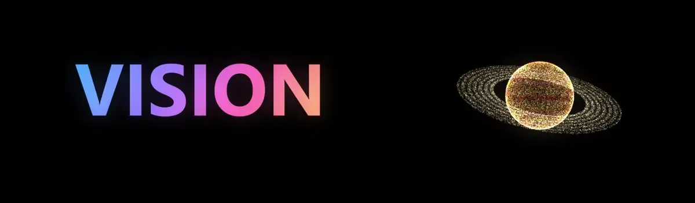
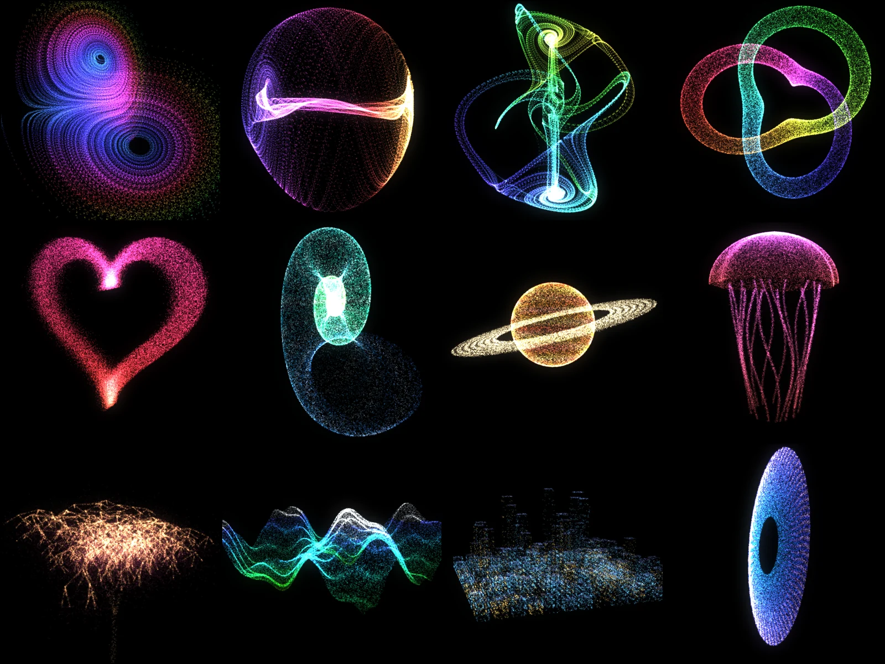

<a href="README.md">Español</a> · <b>English</b>

<h3 align="center">An interface made only of points</h3>

<b>Free demos:</b> <a href="https://virtuanista.github.io/vision/?lang=en">Deck</a> · <a href="https://virtuanista.github.io/vision/?lang=en#texto">Type</a> · <a href="https://virtuanista.github.io/vision/?lang=en#emoji">Emoji</a> · <a href="https://virtuanista.github.io/vision/?lang=en#cubo">Cube</a> · <a href="https://virtuanista.github.io/vision/?lang=en#esfera">Sphere</a> · <a href="https://virtuanista.github.io/vision/?lang=en#nube">Cloud</a>

| | Free | Paid |
|---|---|---|
| Points | 60,000 | 500,000 |
| Buttons | 6 | 512, with folders |
| No-code studio | | Yes |
| Export page, 4K and video | | Yes |
| Original pieces | | 12 |
| Open .splat and .ply | | Yes |

	Repository made by <a href="https://github.com/virtuanista" target="_blank">virtu 🎣</a>

	

	Copyright &copy; 2026

