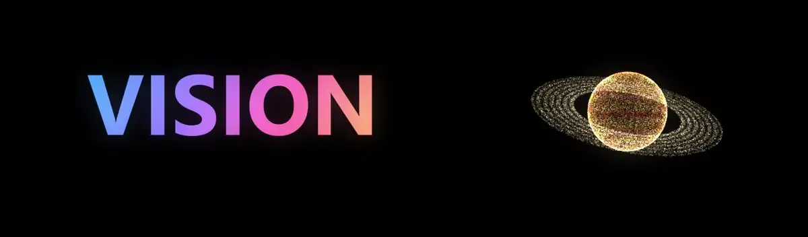
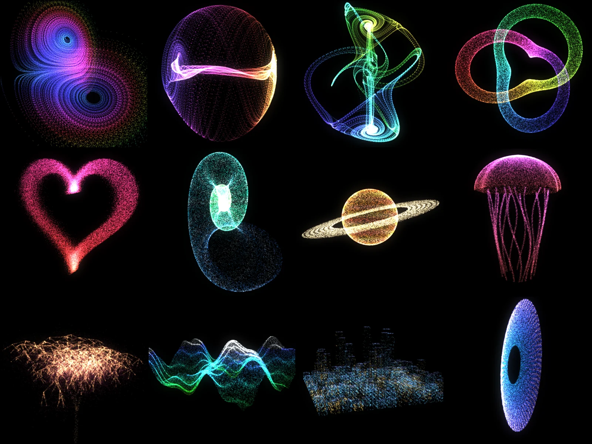

<b>Español</b> · <a href="README.en.md">English</a>

<h3 align="center">Una interfaz hecha solo de puntos</h3>

<b>Demos gratis:</b> <a href="https://virtuanista.github.io/vision/">Tablero</a> · <a href="https://virtuanista.github.io/vision/#texto">Escribe</a> · <a href="https://virtuanista.github.io/vision/#emoji">Emoji</a> · <a href="https://virtuanista.github.io/vision/#cubo">Cubo</a> · <a href="https://virtuanista.github.io/vision/#esfera">Esfera</a> · <a href="https://virtuanista.github.io/vision/#nube">Nube</a>

| | Gratis | De pago |
|---|---|---|
| Puntos | 60.000 | 500.000 |
| Botones | 6 | 512, con carpetas |
| Estudio sin programar | | Sí |
| Exportar página, 4K y vídeo | | Sí |
| Piezas originales | | 12 |
| Abrir .splat y .ply | | Sí |

	Repositorio generado por <a href="https://github.com/virtuanista" target="_blank">virtu 🎣</a>

	

	Copyright &copy; 2026

